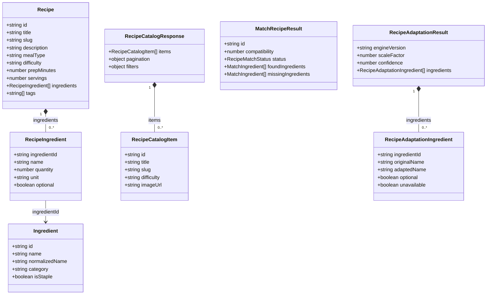

# Diagrama UML de Classes — Frontend

**Visualização direta no GitHub:** o desenho UML aparece abaixo. Não é uma imagem estática; o diagrama é gerado a partir do código Mermaid desta página.

Contratos TypeScript utilizados no Receitando. Não é um diagrama do banco.

**Editar em PlantUML:** [abrir o arquivo-fonte `receitando-contratos-dados-frontend.puml`](receitando-contratos-dados-frontend.puml).

**Base técnica:** [System Design](docs/system-design-fase4.md) · [schema PostgreSQL](backend/worker-prototype/migrations/postgres/0001_baseline.sql) · [índice de diagramas](DIAGRAMAS-EDITAVEIS.md).
