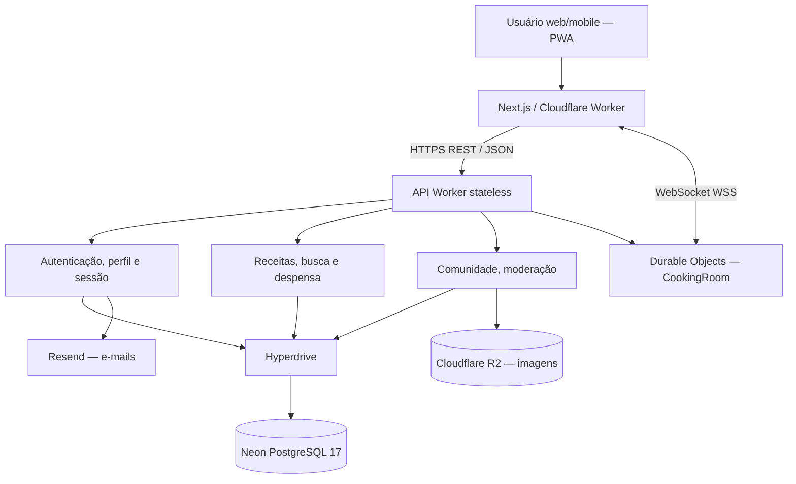

# Diagrama UML de Componentes — Receitando

**Visualização direta no GitHub:** o desenho UML aparece abaixo. Não é uma imagem estática; o diagrama é gerado a partir do código Mermaid desta página.

Next.js, Workers, Hyperdrive, Neon PostgreSQL, R2, Resend e Durable Objects.

**Editar em PlantUML:** [abrir o arquivo-fonte `receitando-diagrama-componentes.puml`](receitando-diagrama-componentes.puml).

**Base técnica:** [System Design](docs/system-design-fase4.md) · [schema PostgreSQL](backend/worker-prototype/migrations/postgres/0001_baseline.sql) · [índice de diagramas](DIAGRAMAS-EDITAVEIS.md).
