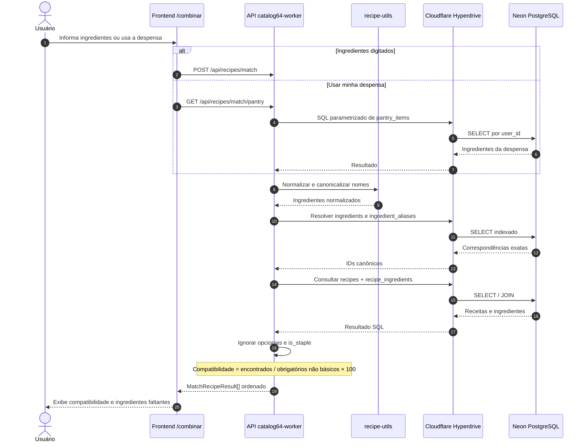

# Diagrama UML de Sequência — Matching

**Visualização direta no GitHub:** o desenho UML aparece abaixo. Não é uma imagem estática; o diagrama é gerado a partir do código Mermaid desta página.

Normalização de ingredientes e consultas PostgreSQL pelo Hyperdrive.

**Editar em PlantUML:** [abrir o arquivo-fonte `receitando-diagrama-sequencia-matching.puml`](receitando-diagrama-sequencia-matching.puml).

**Base técnica:** [System Design](docs/system-design-fase4.md) · [schema PostgreSQL](backend/worker-prototype/migrations/postgres/0001_baseline.sql) · [índice de diagramas](DIAGRAMAS-EDITAVEIS.md).
