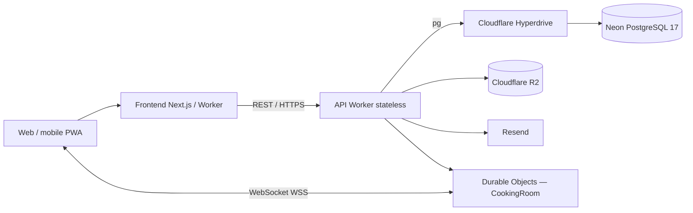

# Receitando

**Receitando** é uma plataforma de receitas que combina descoberta de pratos, aproveitamento de ingredientes da despensa, recursos de comunidade e preparação colaborativa em tempo real.

**[Acessar o Receitando](https://receitando.miguelpita.com.br)** · **[API — saúde](https://api.receitando.miguelpita.com.br/api/health)** · **[Documentação técnica](docs/README.md)**

[](https://github.com/pitado/receitando/actions/workflows/ci.yml)
[](https://github.com/pitado/receitando/actions/workflows/api-worker-ci.yml)
[](LICENSE)

## Arquitetura atual

O frontend é uma aplicação **Next.js 16 / React 19 / TypeScript**, distribuída com Cloudflare Workers/OpenNext e adaptada a navegadores desktop e mobile (PWA). A **API REST stateless** roda em outro Cloudflare Worker. Os dados relacionais e sessões estão no **Neon PostgreSQL 17**, conectado por **Cloudflare Hyperdrive** e driver `pg`. Imagens ficam no **R2**. Salas de preparo compartilhado utilizam **WebSocket e Durable Objects**, com estado isolado por sala. O serviço **Resend** gerencia e-mails.



O Worker HTTP não mantém sessões na memória; informações persistentes ficam no PostgreSQL. O **estado WebSocket** é coordenado separadamente por Durable Objects. Não existe app mobile nativo. A integração de pagamento é apenas um **mapeamento acadêmico**, não um recurso ativo do produto.

## Documentação da Fase 4 — System Design

O professor solicitou uma arquitetura que apresente estratégia para **1 milhão de escritas e 2 milhões de leituras**, REST stateless, frontend web/mobile e mapeamento de WebSocket e API de pagamentos. O foco é a **justificativa arquitetural**, com dimensionamento e tratamento de gargalos — não executar obrigatoriamente 3 milhões de chamadas HTTP.

| Material | Prévia | Editar / fonte |
| --- | --- | --- |
| **Documento obrigatório de System Design** | [Fase 4 — System Design](docs/system-design-fase4.md) | [Código e infraestrutura](docs/architecture.md) |
| **Diagrama de componentes real** | [Visualizar no GitHub](docs/diagramas/componentes.md) | [Componentes.drawio](receitando-diagrama-componentes.drawio) |
| **DER Neon PostgreSQL 17** | [Visualizar no GitHub](docs/diagramas/der.md) | [DER.drawio](DER.drawio) · [DBML](receitando-der.dbml) |
| **UML — Matching** | [Visualizar no GitHub](docs/diagramas/sequencia-matching.md) | [Sequência.drawio](Diagrama-de-Sequencia.drawio) · [PlantUML](receitando-diagrama-sequencia-matching.puml) |
| **UML — Envio e moderação** | [Visualizar no GitHub](docs/diagramas/sequencia-envio-moderacao.md) | [Moderação.drawio](receitando-diagrama-sequencia-envio-moderacao.drawio) · [PlantUML](receitando-diagrama-sequencia-envio-moderacao.puml) |
| **WebSocket Receitando Juntos** | [Especificação](docs/receitando-juntos.md) | [Worker CookingRoom](backend/worker-prototype/src/cooking-room.ts) |
| **Evidências de engenharia** | [Metodologia e resultados](tests/load/README.md) | [Workflow HTTP/Neon isolado](.github/workflows/neon-http-real.yml) |

Os diagramas `.drawio` são **editáveis no diagrams.net**, com componentes, relações, conectores e rótulos. As páginas `.md` apresentam prévias Mermaid no GitHub. Leia também o [índice de diagramas](DIAGRAMAS-EDITAVEIS.md).

### Estratégia para suportar a volumetria

- **Workers:** distribuição horizontal de processamento REST sem sessões em memória por instância.
- **Hyperdrive:** gestão de conexões entre a borda e o PostgreSQL.
- **Neon PostgreSQL:** índices, paginação, consultas eficientes, transações e ampliação do compute conforme a carga.
- **R2:** armazenar arquivos sem sobrecarregar o banco relacional.
- **Durable Objects:** coordenação isolada e consistente de eventos WebSocket por sala.
- **Operação:** métricas de latência e erro, controle de taxa, cache seguro para informações públicas e análise de gargalos.

Os ensaios registrados em [testes de carga](tests/load/README.md) são complementares à proposta. **Não** equivalem a uma certificação de 3 milhões de requisições HTTP sustentadas na infraestrutura atual.

## Funcionalidades

- **Receitas:** catálogo, filtros, busca textual, detalhes e fontes.
- **Combinador:** receitas compatíveis com ingredientes disponíveis; normalização e aliases canônicos.
- **Despensa:** quantidades opcionais, validade, aproveitamento prioritário e lista de compras.
- **Contas e comunidade:** cadastro, login, favoritos, comentários, avaliações e submissão de receitas com moderação.
- **Adaptação culinária:** ajuste de rendimento e substituições contextualizadas.
- **Receitando Juntos:** salas por convite com sincronização de etapas, presença e recuperação após reconexão.

Receitas autorais e da comunidade são separadas de **links editoriais** para sites de terceiros. A referência à fonte não autoriza copiar conteúdo ou fotografias protegidos.

## Estrutura

```text
frontend/                               Next.js, React, interface e testes
backend/worker-prototype/
  src/                                  API REST, adaptador PostgreSQL e CookingRoom
  migrations/postgres/                  Schema e seeds PostgreSQL
  scripts/                              Testes e importação de links autorizados
  tests/                                Testes da API e camada PostgreSQL
docs/                                   System Design, API, banco e diagramas Mermaid
tests/load/                             Evidências e scripts de benchmark isolado
.github/workflows/                      CI, deploy e verificações manuais
```

## Desenvolvimento

Recomendado: **Node.js 22**.

```bash
# terminal 1
cd frontend
npm ci
npm run dev

# terminal 2
cd backend/worker-prototype
npm ci
npm run dev
```

A API requer **PostgreSQL de desenvolvimento isolado** para executar rotas que consultam dados. Configure o Hyperdrive local conforme o [guia de deploy e ambientes](docs/deploy.md); não usar credenciais ou dados de produção em testes.

**Validação da API:**
```bash
cd backend/worker-prototype
npm run typecheck
npm test
npm run test:postgres
npm run test:ws
npm run dry-run
```

**Validação do frontend:** `npm run lint`, `npm run typecheck` e `npm run test:coverage`. A integração PostgreSQL de CI utiliza um banco temporário separado do Neon de produção.

## Guias

[Arquitetura](docs/architecture.md) · [Schema PostgreSQL](docs/database.md) · [API](docs/api.md) · [Deploy](docs/deploy.md) · [Catálogo e licenças](docs/catalogo.md) · [Contribuindo](CONTRIBUTING.md) · [Segurança](SECURITY.md)

**Licença:** código original sob [GNU AGPL-3.0](LICENSE). Textos, receitas e imagens de terceiros seguem suas próprias licenças e atribuições.
