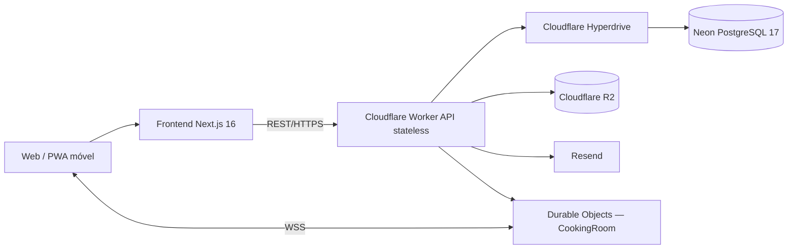

# Receitando

**Receitando** é uma aplicação web de receitas, organização da despensa, recomendação por ingredientes e preparo colaborativo em tempo real.

**[Abrir o Receitando](https://receitando.miguelpita.com.br)** · **[API](https://api.receitando.miguelpita.com.br/api/health)**

[](https://github.com/pitado/receitando/actions/workflows/ci.yml) [](https://github.com/pitado/receitando/actions/workflows/api-worker-ci.yml) [](LICENSE)

## Fase 4 — System Design e Infraestrutura

O projeto documenta a arquitetura para **1 milhão de escritas e 2 milhões de leituras**, backend REST stateless, frontend web/mobile, integração WebSocket e desenho de API de pagamentos hipotética.

| Material | Acesso |
| --- | --- |
| **Documento obrigatório de System Design** | [Ler System Design — Fase 4](docs/system-design-fase4.md) |
| **Diagrama de componentes** | [Prévia visual no GitHub](docs/diagramas/componentes.md) |
| **DER PostgreSQL** | [Prévia visual no GitHub](docs/diagramas/der.md) · [Editar arquivo .drawio](DER.drawio) |
| **Sequência UML: matching** | [Prévia](docs/diagramas/sequencia-matching.md) · [Editar .drawio](Diagrama-de-Sequencia.drawio) |
| **Teste de carga SQL real** | [Metodologia, números e limites](tests/load/README.md) |
| **WebSocket Receitando Juntos** | [Especificação e testes](docs/receitando-juntos.md) |
| **Índice de documentação** | [Todos os documentos](docs/README.md) |

A defesa arquitetural pública será preparada em **slides separados**, conforme a exigência de apresentação. Este repositório mantém o documento técnico e evidências. A avaliação de escalabilidade distingue **operações SQL executadas** de **requisições HTTP de ponta a ponta**.

## Arquitetura técnica



| Camada | Escolha atual |
| --- | --- |
| Frontend | **Next.js 16**, React 19, TypeScript, OpenNext, Cloudflare Workers |
| Backend | **API REST stateless** em Cloudflare Worker |
| Banco relacional | **Neon PostgreSQL 17**, conectado via **Cloudflare Hyperdrive** |
| Dados binários | Cloudflare **R2** |
| Tempo real | **Durable Objects + WebSocket** |
| E-mail | **Resend** |
| CI/CD | **GitHub Actions** |

O frontend é **web responsivo/PWA**, acessível de celulares, não aplicativo nativo. O Worker REST não armazena sessões na memória de uma instância. As sessões e dados de usuário persistem no banco; cada sala WebSocket tem seu próprio estado no Durable Object.

### Evidência de dimensionamento

Em **31/10/2026**, um teste **isolado no Neon PostgreSQL 17.11** registrou 1 milhão de linhas e confirmou 2 milhões de buscas por chave primária indexada, usando dados sintéticos. Isso **não equivale** a 3 milhões de requisições HTTP na API nem garante os mesmos resultados sob concorrência em produção.

A estratégia para suportar o volume combina Workers horizontais, pooling Hyperdrive, índices e paginação PostgreSQL, armazenamento de imagem separado, controle de taxas, métricas e possibilidade de ampliar a capacidade do Neon. [Entenda os cálculos, gargalos e trade-offs](docs/system-design-fase4.md).

## Funcionalidades

**Receitas e descoberta:** catálogo, filtros, busca textual, páginas detalhadas, ingredientes normalizados e suas variações, cálculo de compatibilidade com o que existe em casa.

**Despensa:** cadastro de alimentos e validade opcional; priorização de receitas que aproveitam itens próximos do vencimento e lista de compras com ingredientes faltantes. O matching básico trabalha por presença do ingrediente, não pela quantidade exata disponível.

**Comunidade:** conta e sessão com cookie seguro, perfil, favoritos, votos, comentários e publicação de receitas da comunidade com moderação. Imagens são enviadas para o R2.

**Adaptação culinária:** cálculo de porções e substituições de ingredientes com contextualização e indicação das limitações.

**Receitando Juntos:** salas compartilhadas com convite, sincronização de etapas, presença, alterações concorrentes e recuperação do estado após reconexão. As salas têm expiração e limites de conexões.

**Fontes:** receitas autorais e conteúdo submetido com responsabilidade editorial; referências de sites brasileiros são **links para a fonte**, e não autorização para copiar receita ou foto de terceiros.

## Estrutura de pastas

```text
receitando/
├── frontend/                             Next.js, interface e testes
├── backend/worker-prototype/
│   ├── src/                              API, módulos e WebSocket
│   ├── migrations/postgres/              Schema PostgreSQL versionado
│   ├── scripts/                          Testes e referências editoriais
│   └── tests/                            Testes de rotas e persistência
├── docs/                                 System Design e documentação
├── tests/load/                           Evidências e cenários de carga
└── .github/workflows/                    Integração e deploy
```

## Executar para desenvolvimento

Recomendado: **Node.js 22**.

```bash
cd frontend
npm ci
npm run dev
```

API (em outro terminal):

```bash
cd backend/worker-prototype
npm ci
npm run typecheck
npm run dev
```

Para endpoints que consultam dados, configure uma **conexão PostgreSQL de desenvolvimento isolada** no Hyperdrive local. Não utilizar a branch Neon `production` para fixtures ou testes de estresse.

## Testes

No backend:

```bash
npm run typecheck
npm test
npm run test:postgres
npm run test:ws
```

A integração com schema real exige `POSTGRES_TEST_URL` apontando para **PostgreSQL local temporário**. O CI cria esse serviço e executa as verificações. O teste de sala usa dois clientes WebSocket locais, sem tocar em usuários reais. O workflow de carga `.github/workflows/load-test.yml` contém os cenários `smoke`, `professor-check` e `professor`, configurados com PostgreSQL isolado e k6; só resultados efetivamente executados devem ser apresentados como evidência.

## Documentação

[Arquitetura](docs/architecture.md) · [Banco PostgreSQL](docs/database.md) · [API](docs/api.md) · [Deploy](docs/deploy.md) · [Catálogo e direitos](docs/catalogo.md) · [Documentação completa](docs/README.md)

Código original sob licença **GNU AGPL-3.0**; imagens, textos externos e contribuições preservam os direitos/licenças específicos de seus autores.
