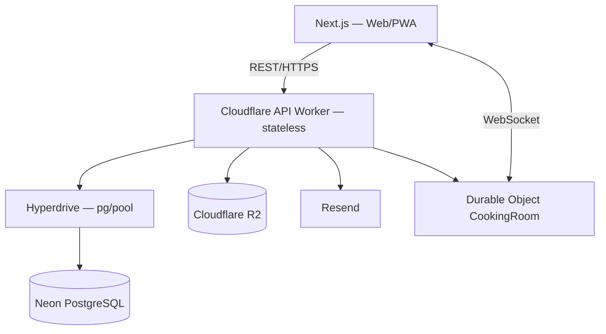

# Arquitetura técnica do Receitando

## Infraestrutura em execução
- **Cliente:** Next.js 16, React 19, TypeScript/OpenNext em Cloudflare Workers, responsivo em navegador desktop e mobile.
- **API:** Worker TypeScript independente, roteamento em `src/session-cookie-worker.ts` e `src/app-router.ts`, REST/JSON, HTTPS e cookie seguro.
- **Banco:** **Neon PostgreSQL 17**. O backend usa `pg` pelo binding **Cloudflare Hyperdrive** para conexões gerenciadas.
- **Objetos:** Cloudflare R2 para imagens; **Durable Objects** para salas de preparo colaborativo.
- **Comunicação:** REST para operações tradicionais; WSS para etapas e presença.
- **Outros serviços:** Resend para e-mails; GitHub Actions para CI/CD.

**Stateless:** o processo HTTP não mantém estado de sessão; a persistência fica no PostgreSQL. O WebSocket tem estado coordenado em Durable Objects independentes, sem tornar o Worker HTTP stateful.

**Escala e limites:** Workers horizontais, Hyperdrive para conexões, índices e paginação no banco, armazenamento de imagem segregado. Observabilidade, proteção a picos, controle de custos e dimensionamento de compute Neon são indispensáveis; horizontalizar Worker não remove limitações do Postgres.

[Documento de System Design](system-design-fase4.md) · [Diagrama de componentes](diagramas/componentes.md) · [Esquema PostgreSQL](../backend/worker-prototype/migrations/postgres/0001_baseline.sql) · [Receitando Juntos](receitando-juntos.md).
