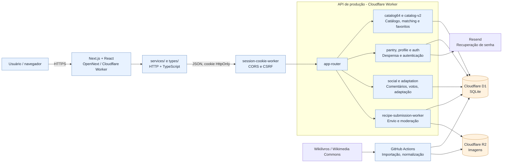

# Componentes da arquitetura

Visão de frontend, API, Workers, banco D1, bucket R2, autenticação e importação.

**Prévia visual gerada pelo GitHub usando Mermaid:**

**Para editar as caixas e conexões:** [abrir o arquivo-fonte `.drawio`](../../receitando-diagrama-componentes.drawio). O GitHub exibe o XML quando você abre um `.drawio` diretamente; por isso esta página fornece a visualização sem precisar instalar ou baixar nada.

[Voltar ao índice dos diagramas](../../DIAGRAMAS-EDITAVEIS.md)
