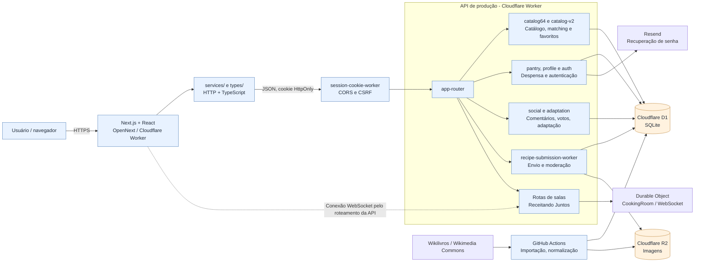

# Componentes da arquitetura

O diagrama mostra por onde passam as requisições do frontend e quais serviços a API utiliza. Incluímos também as salas compartilhadas do Receitando Juntos.

A criação das salas e o encaminhamento do WebSocket estão implementados no backend. A validação de sincronização entre dispositivos ainda é uma etapa de teste. O fluxo das mensagens está detalhado em [Receitando Juntos — WebSocket](../websocket-receitando-juntos.md).

**Arquivo editável:** [abrir o arquivo-fonte `.drawio`](../../receitando-diagrama-componentes.drawio). O GitHub exibe o XML quando você abre um `.drawio` diretamente; por isso esta página fornece a visualização sem precisar instalar ou baixar nada.

[Voltar ao índice dos diagramas](../../DIAGRAMAS-EDITAVEIS.md)
