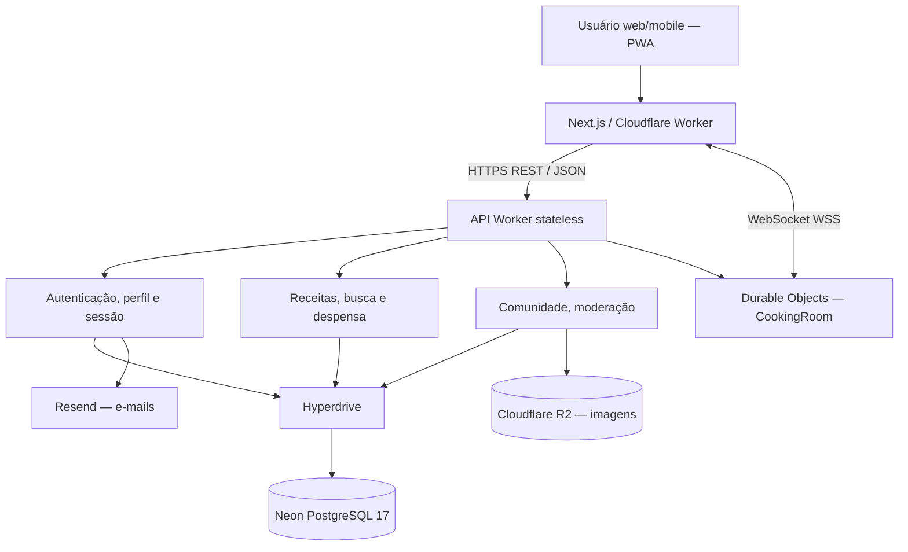

# Diagrama de componentes — Receitando

O Worker REST é stateless; cookies seguros identificam sessões persistidas no PostgreSQL. O estado por sala WebSocket é independente e coordenado por um Durable Object. Imagens ficam no R2, não no banco relacional.

[System Design](../system-design-fase4.md) · [Schema PostgreSQL](../../backend/worker-prototype/migrations/postgres/0001_baseline.sql) · [WebSocket](../receitando-juntos.md).
