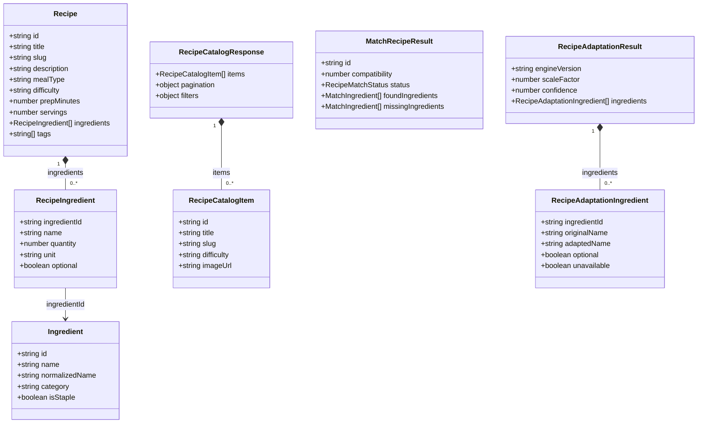

# Contratos TypeScript do frontend

Principais tipos e interfaces de `frontend/src/types/recipe.ts`. Este é um modelo lógico do frontend, não um diagrama de banco.

**Prévia visual gerada pelo GitHub usando Mermaid:**

**Fonte UML textual editável:** [receitando-contratos-dados-frontend.puml](../../receitando-contratos-dados-frontend.puml). Os tipos de código continuam em [recipe.ts](../../frontend/src/types/recipe.ts).

[Voltar ao índice dos diagramas](../../DIAGRAMAS-EDITAVEIS.md)
