# DER — Neon PostgreSQL

Modelo relacional simplificado do catálogo, usuários, despensa e comunidade, baseado no [schema PostgreSQL versionado](../../backend/worker-prototype/migrations/postgres/0001_baseline.sql). O código SQL é a fonte de verdade para campos, índices e restrições.

```mermaid
erDiagram
  USERS ||--o{ SESSIONS : "user_id"
  USERS ||--o{ PANTRY_ITEMS : "user_id"
  USERS ||--o{ FAVORITES : "user_id"
  USERS ||--o{ RECIPE_VOTES : "user_id"
  USERS ||--o{ RECIPE_COMMENTS : "user_id"
  USERS o|--o{ RECIPE_SUBMISSIONS : "user_id"
  RECIPES ||--o{ RECIPE_INGREDIENTS : "recipe_id"
  INGREDIENTS ||--o{ RECIPE_INGREDIENTS : "ingredient_id"
  INGREDIENTS ||--o{ INGREDIENT_ALIASES : "ingredient_id"
  INGREDIENTS ||--o{ PANTRY_ITEMS : "ingredient_id"
  RECIPES ||--o{ FAVORITES : "recipe_id"
  RECIPES ||--o{ RECIPE_VOTES : "recipe_id"
  RECIPES ||--o{ RECIPE_COMMENTS : "recipe_id"
  RECIPES ||--o{ RECIPE_TAGS : "recipe_id"
  USERS {
    text id PK
    text email UK
    text password_hash
  }
  SESSIONS {
    text id PK
    text user_id FK
    text token_hash UK
  }
  RECIPES {
    text id PK
    text slug UK
    text title
  }
  INGREDIENTS {
    text id PK
    text normalized_name UK
  }
  RECIPE_INGREDIENTS {
    text id PK
    text recipe_id FK
    text ingredient_id FK
  }
  PANTRY_ITEMS {
    text id PK
    text user_id FK
    text ingredient_id FK
  }
  FAVORITES {
    text user_id PK,FK
    text recipe_id PK,FK
  }
  INGREDIENT_ALIASES {
    text id PK
    text ingredient_id FK
  }
  RECIPE_VOTES {
    text user_id PK,FK
    text recipe_id PK,FK
  }
  RECIPE_COMMENTS {
    text id PK
    text user_id FK
    text recipe_id FK
  }
  RECIPE_SUBMISSIONS {
    text id PK
    text user_id FK
  }
  RECIPE_TAGS {
    text recipe_id PK,FK
  }
```

O [DER em PlantUML](../../DER.puml) é a fonte editável em texto; o [DBML](../../receitando-der.dbml) é uma representação relacional complementar. O schema PostgreSQL versionado é a fonte de verdade. [Ver banco](../database.md).
