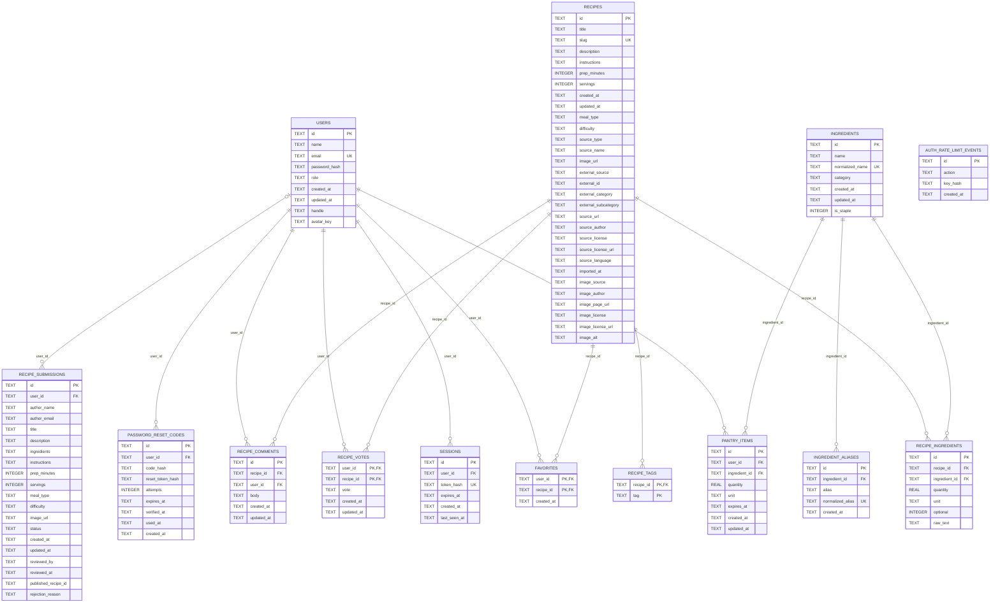

# DER do banco de dados

Modelo físico do banco Cloudflare D1 (SQLite): 14 tabelas, 15 relacionamentos FK, chaves PK e tipos de dados. O índice virtual FTS5 `recipe_search` fica documentado separadamente.

**Prévia visual gerada pelo GitHub usando Mermaid:**

**Para editar as caixas e conexões:** [abrir o arquivo-fonte `.drawio`](../../DER.drawio). O GitHub exibe o XML quando você abre um `.drawio` diretamente; por isso esta página fornece a visualização sem precisar instalar ou baixar nada.

[Voltar ao índice dos diagramas](../../DIAGRAMAS-EDITAVEIS.md)
