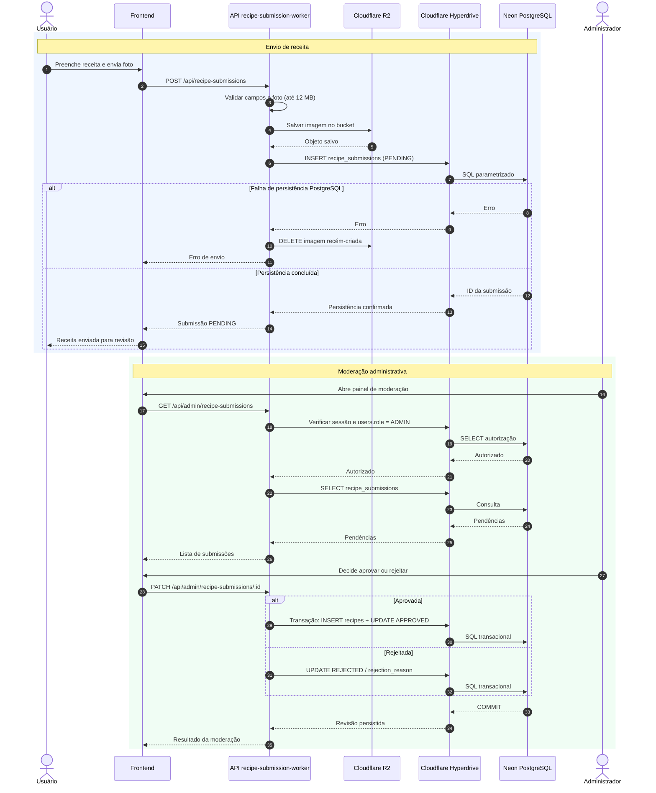

# Sequência UML — envio e moderação

Fluxo de envio de receitas com foto, persistência no PostgreSQL, limpeza em caso de erro e revisão administrativa.

**Prévia visual gerada pelo GitHub usando Mermaid:**

**Fonte UML textual editável:** [receitando-diagrama-sequencia-envio-moderacao.puml](../../receitando-diagrama-sequencia-envio-moderacao.puml). A prévia acima usa Mermaid no GitHub.

[Voltar ao índice dos diagramas](../../DIAGRAMAS-EDITAVEIS.md)
