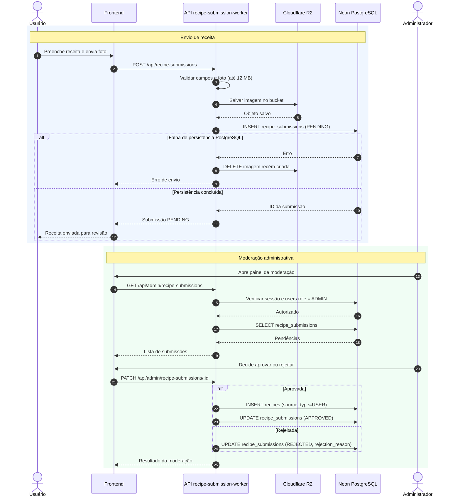

# Sequência UML — envio e moderação

Fluxo de envio de receitas com foto, persistência no PostgreSQL, limpeza em caso de erro e revisão administrativa.

**Prévia visual gerada pelo GitHub usando Mermaid:**

**Para editar as caixas e conexões:** [abrir o arquivo-fonte `.drawio`](../../receitando-diagrama-sequencia-envio-moderacao.drawio). O GitHub exibe o XML quando você abre um `.drawio` diretamente; por isso esta página fornece a visualização sem precisar instalar ou baixar nada.

[Voltar ao índice dos diagramas](../../DIAGRAMAS-EDITAVEIS.md)
