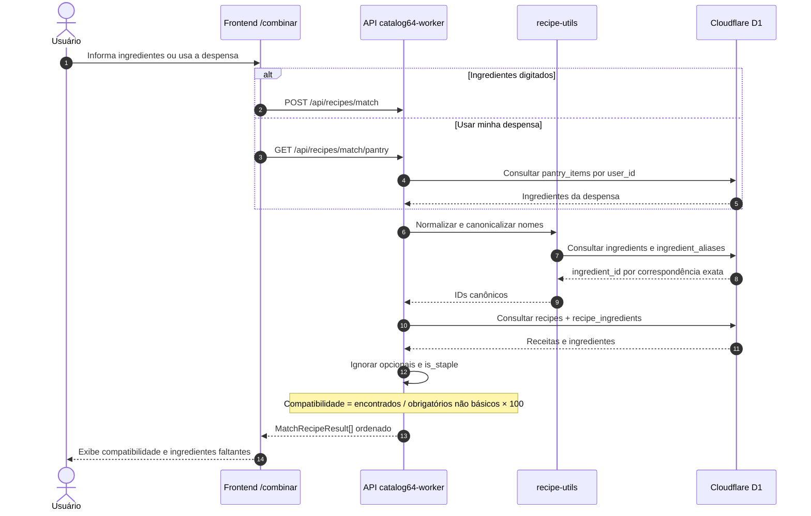

# Sequência UML — busca por ingredientes

Como os ingredientes digitados ou os itens da despensa chegam à API, são normalizados, consultados no D1 e usados para calcular a compatibilidade.

**Prévia visual gerada pelo GitHub usando Mermaid:**

**Para editar as caixas e conexões:** [abrir o arquivo-fonte `.drawio`](../../receitando-diagrama-sequencia-matching.drawio). O GitHub exibe o XML quando você abre um `.drawio` diretamente; por isso esta página fornece a visualização sem precisar instalar ou baixar nada.

[Voltar ao índice dos diagramas](../../DIAGRAMAS-EDITAVEIS.md)
