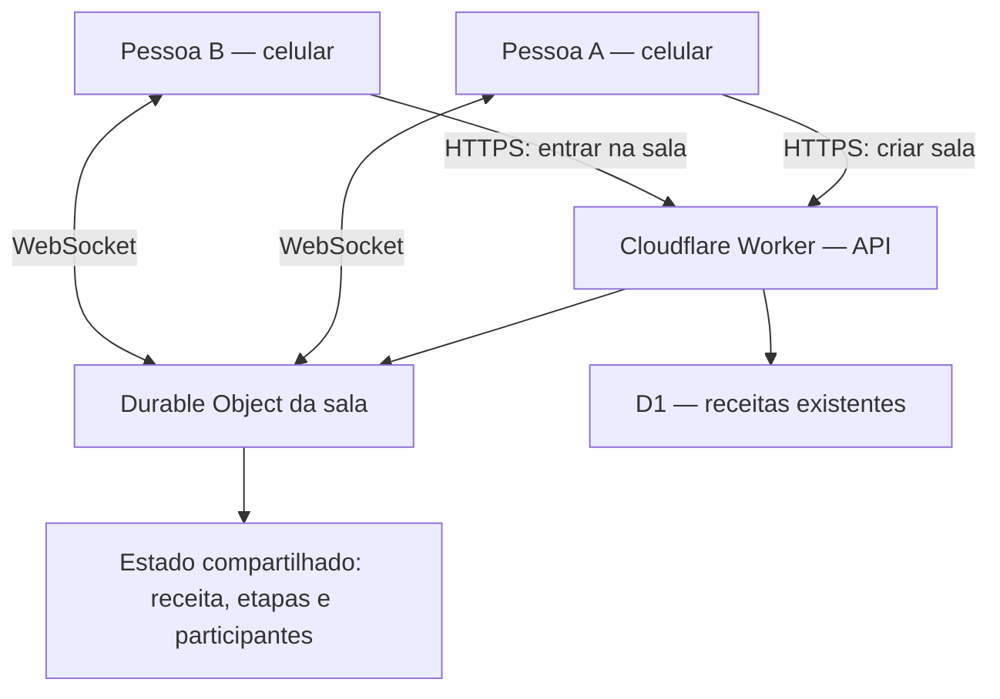

# Receitando Juntos — Cozinhar em tempo real

> **Proposta de funcionalidade para o Receitando | Fase 4 — System Design**
>
> **Status:** proposta técnica para aprovação do grupo. **Ainda não implementada** no site. O objetivo deste documento é alinhar escopo, experiência e arquitetura antes do desenvolvimento.

## 1. Ideia

**Receitando Juntos** permite que duas ou mais pessoas preparem a mesma receita acompanhando, em seus próprios celulares, um passo a passo compartilhado em tempo real. Um participante cria uma sala e envia um link; os demais entram e visualizam imediatamente as alterações de progresso.

A proposta aproveita as receitas e instruções já existentes no Receitando, sem exigir cadastro novo, aplicativo nativo ou pagamento.

## 2. Problema que resolve

Quando duas pessoas cozinham juntas, precisam coordenar o preparo: quem está em qual etapa, o que já foi feito e quanto tempo falta. Enviar mensagens ou perguntar repetidamente atrapalha a experiência. O Receitando Juntos mantém todos na mesma página.

## 3. Fluxo do usuário (MVP)

1. O usuário abre o detalhe de uma receita e seleciona **Cozinhar junto**.
2. O sistema cria uma sala temporária vinculada àquela receita e mostra um link compartilhável.
3. O anfitrião envia o link pelo WhatsApp ou outro aplicativo.
4. Quem abre o link entra na sala com um apelido, sem precisar criar conta.
5. Todos visualizam a receita, o número de participantes e o progresso compartilhado.
6. Ao marcar ou desmarcar uma etapa, o servidor valida a ação e a transmite a todos os participantes conectados.
7. Ao entrar ou reconectar, cada participante recebe o estado atual da sala.
8. O anfitrião pode encerrar a sessão; salas inativas expiram automaticamente.

## 4. Funcionalidades do MVP

| Funcionalidade | Prioridade |
| --- | --- |
| Botão “Cozinhar junto” na página de receita | Essencial |
| Criar sala e copiar link de convite | Essencial |
| Entrar em sala por link | Essencial |
| Sincronização de etapas concluídas via WebSocket | Essencial |
| Estado inicial e recuperação após reconexão | Essencial |
| Contagem de participantes conectados | Essencial |
| Encerrar sessão e expiração de salas | Essencial |
| Indicador de conexão/reconexão | Essencial |
| Cronômetro compartilhado | Evolução futura |
| Distribuição de tarefas entre participantes | Evolução futura |
| Reações e mensagens rápidas | Evolução futura |

## 5. Arquitetura proposta

O frontend existente é **Next.js / React / TypeScript**, com experiência web responsiva/PWA. A API existente usa **Cloudflare Workers**. Para manter o estado compartilhado e as conexões WebSocket, propomos **Cloudflare Durable Objects**, com um objeto por sala.



**Por que Durable Objects?** O mesmo objeto recebe os eventos da mesma sala e pode coordenar alterações sequenciais, evitando que cada instância de Worker mantenha um estado diferente. A persistência do estado da sala deve ser implementada no armazenamento do próprio Durable Object; a conexão WebSocket sozinha não garante persistência.

## 6. Contratos sugeridos

| Método / canal | Caminho sugerido | Objetivo |
| --- | --- | --- |
| `POST` | `/api/v2/cooking-rooms` | Criar sala para uma receita existente |
| `GET` | `/api/v2/cooking-rooms/:id` | Consultar metadados públicos da sala |
| `GET` + Upgrade | `/api/v2/cooking-rooms/:id/ws` | Conectar WebSocket |
| WebSocket | `join` | Entrar com apelido |
| WebSocket | `step:set` | Marcar/desmarcar uma etapa |
| WebSocket | `room:state` | Receber estado completo e versão |
| WebSocket | `presence:update` | Atualizar participantes online |
| WebSocket | `room:closed` | Notificar encerramento |

Exemplo ilustrativo de mensagem de cliente:

```json
{
  "type": "step:set",
  "stepIndex": 2,
  "completed": true
}
```

Exemplo de evento de servidor:

```json
{
  "type": "room:state",
  "version": 8,
  "completedSteps": [true, false, true, false],
  "onlineCount": 2
}
```

**Regra:** o servidor é a fonte da verdade. Clientes não devem definir arbitrariamente o número de participantes, a versão ou o identificador da receita.

## 7. Segurança e privacidade

- IDs de sala aleatórios e difíceis de adivinhar; convite funciona como um segredo compartilhável.
- Verificação de origem (`Origin`) e validação de todas as mensagens e tamanhos.
- Limites de participantes, mensagens por segundo, duração e quantidade de salas criadas.
- Não transmitir e-mail, sessão de autenticação, dados pessoais ou cookies para outros participantes.
- Definir política de expiração e limpeza de salas.
- Restringir a criação de salas para evitar abuso e consumo inesperado de recursos.
- Reconexão com estado completo, para evitar divergências depois de quedas de internet.

## 8. Critérios de aceite

1. Duas abas/dispositivos entram na mesma sala.
2. Ao marcar uma etapa no aparelho A, ela muda no B sem atualizar a página.
3. Uma pessoa que entrar depois vê o progresso atual.
4. Ao perder a conexão e voltar, o estado é recuperado corretamente.
5. Ações inválidas não derrubam a sala.
6. Pessoas em salas diferentes não recebem eventos umas das outras.
7. Uma sala encerrada não aceita novas alterações.

## 9. Relação com a Fase 4

Esta funcionalidade demonstra **comunicação bidirecional em tempo real**, **separação entre frontend e backend**, **controle de estado por sala**, **concorrência**, **escalabilidade horizontal de salas independentes** e **segurança de conexões persistentes**.

Ela complementa, mas **não substitui**, o teste de 1 milhão de escritas e 2 milhões de leituras, que mede outra parte da arquitetura. Se o professor exigir integração de pagamentos, monetização via AdSense também não substitui automaticamente esse requisito.

## 10. Divisão sugerida para o grupo

- **Frontend:** botão, tela da sala, etapas, participantes e indicador de conexão.
- **Backend:** criação/expiração de salas, Durable Object e WebSocket.
- **Qualidade:** testes de sincronização, reconexão, concorrência e segurança.
- **Documentação:** diagramas, contratos, decisões arquiteturais e demonstração.

## 11. Demonstração para o professor

Abrir a mesma receita em dois celulares, criar uma sala, compartilhar o link e marcar uma etapa no primeiro aparelho. A atualização deve aparecer no segundo **sem recarregar a página**. Em seguida, desconectar e reconectar um aparelho para comprovar a recuperação do estado.

**Resumo para apresentação:** “O Receitando Juntos transforma uma receita estática em uma experiência colaborativa. Usamos WebSocket para sincronização instantânea e Durable Objects para coordenar o estado de cada sala, mantendo a aplicação web responsiva já existente.”
