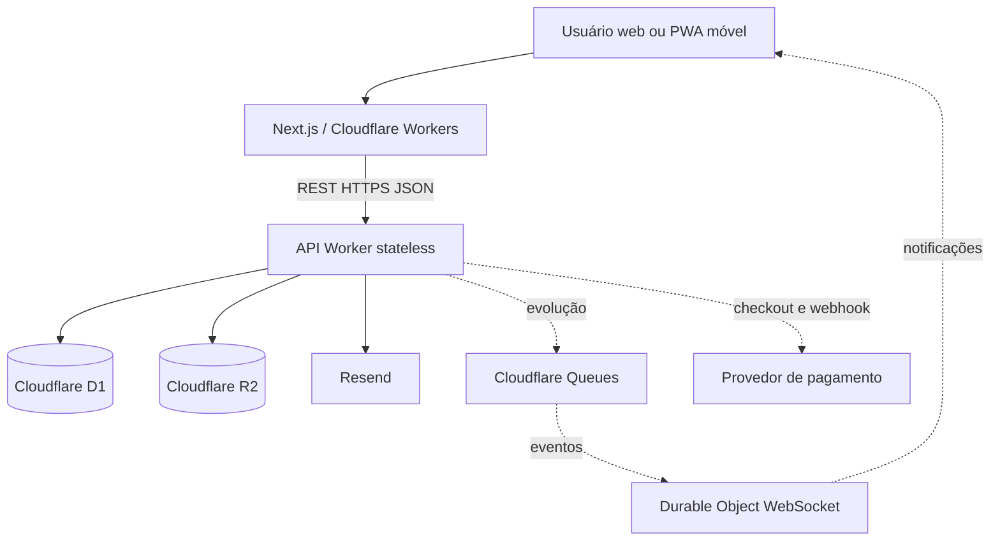
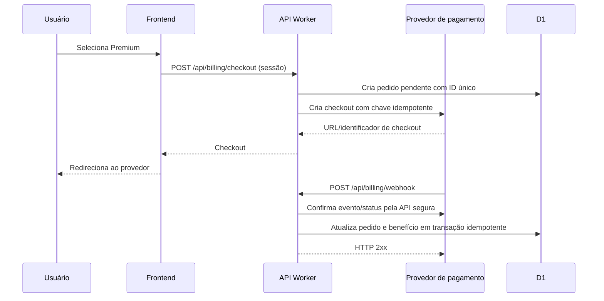
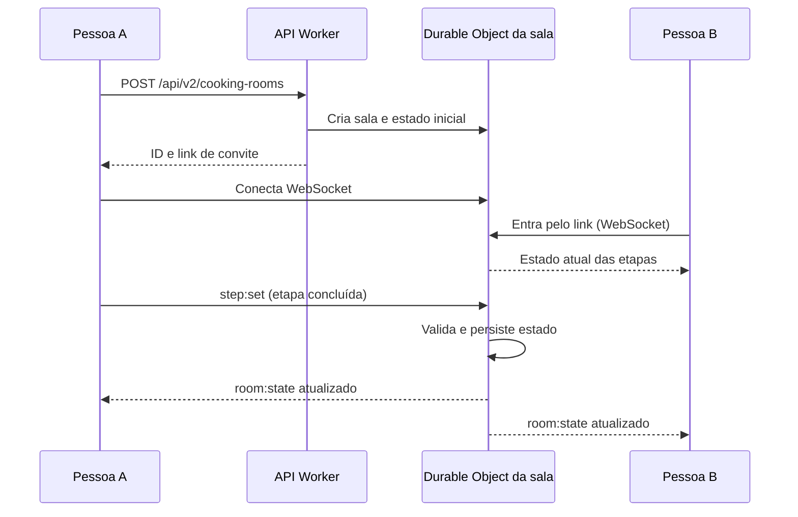

# Fase 4 — System Design e Infraestrutura | Receitando

**Data:** 29/10/2026. **Escopo:** desenho arquitetural, escalabilidade e integração externa. **Convenção:** **[ATUAL]** implementado e identificado no repositório; **[PROPOSTO]** solução projetada, ainda não implementada; **[A VALIDAR]** hipótese que exige medição.

## 1. Objetivo e requisitos

Arquitetura de backend REST sem estado de processo, frontend web e acesso móvel, capacidade-alvo de **1 milhão de escritas e 2 milhões de leituras**, integração com pagamento e comunicação em tempo real via WebSocket. O enunciado não informa o período dessas operações; portanto, não se pode garantir capacidade sem definir a janela.

## 2. Arquitetura atual

- **[ATUAL]** Frontend Next.js 16, React 19 e TypeScript, executado via OpenNext/Cloudflare Workers. Interface responsiva/PWA acessível em dispositivos móveis, não aplicativo móvel nativo.
- **[ATUAL]** API REST em Cloudflare Worker independente, roteada por `src/session-cookie-worker.ts` e `src/app-router.ts`, com JSON sobre HTTPS.
- **[ATUAL]** Persistência em Cloudflare D1 (SQLite), imagens em Cloudflare R2, e-mail transacional via Resend.
- **[ATUAL]** Sessões persistidas e transportadas por cookie HttpOnly/Secure/SameSite; a instância Worker não mantém sessão em memória entre chamadas. Controles de Origin e rate limiting complementam segurança.
- **[ATUAL]** GitHub Actions para CI/CD.
- **[EM VALIDAÇÃO]** Receitando Juntos possui implementação inicial de WebSocket/Durable Objects no repositório, mas ainda exige testes de integração, implantação e demonstração entre dispositivos. **[NÃO IMPLEMENTADO]** Cobrança e fila de eventos dedicada. **[A VALIDAR]** Resultado final do cenário de 3 milhões de operações.

Linhas contínuas: arquitetura existente. Linhas pontilhadas: propostas.

## 3. Escalabilidade: premissas, matemática e gargalos

| Janela para 1M writes + 2M reads | Escritas/s médias | Leituras/s médias | Total/s médio |
|---|---:|---:|---:|
| 24 horas | 11,57 | 23,15 | 34,72 |
| 1 hora | 277,78 | 555,56 | 833,33 |

**[A VALIDAR]** Considerar picos de 10 vezes a média, testar p95/p99, erros, CPU, limites D1, contenção de escrita, custo e consistência. A multiplicação é um cenário de planejamento, não uma medição.

**Plano de evolução [PROPOSTO]:**
1. Cache na borda **apenas** de respostas públicas que permitam cache; rotas autenticadas e personalizadas permanecem privadas. A política atual de `no-store` exige revisão explícita por endpoint.
2. Índices SQL e paginação; examinar planos de consulta e eliminar consultas desnecessárias.
3. Réplicas de leitura D1, com estratégia de consistência/bookmarks quando aplicável; réplicas **não aumentam** a capacidade de escrita do primário.
4. Fila assíncrona para e-mail, notificações e trabalhos não críticos, com idempotência, retry e dead-letter queue.
5. Se a escrita do D1 for insuficiente, considerar particionamento por domínio/tenant ou outra estratégia de persistência, justificada por medições.
6. Observabilidade: métricas, logs estruturados, traces/correlation-id, alertas, custo e limites.

## 4. Estratégia de testes

**[ATUAL — EXECUTADO]** `tests/load/receitando-read.js` testa endpoints públicos GET com k6; a execução inicial de leitura concluiu com 1.060 requisições e zero falhas no ambiente local (não equivale a capacidade de produção). **[A VALIDAR]** `tests/load/receitando-professor.js` configura 1 milhão de escritas sintéticas e 2 milhões de leituras em D1 local; o resultado depende da conclusão e análise da execução do GitHub Actions.

**[A VALIDAR]** Confirmar que o workflow sobe corretamente, endpoints respondem 200, taxa de falhas inferior a 1% e p95 inferior a 1 s (metas iniciais, ajustáveis). Um runner GitHub não representa a capacidade real da Cloudflare.

**[PROPOSTO]** Criar ambiente staging com D1 separado e dados sintéticos. Executar cenários de leitura e escrita na proporção 2:1, ramp-up, pico, endurance e recuperação; exportar JSON e logs, informar duração, VUs, RPS, p95/p99, falhas, custos e limitações. Não executar carga destrutiva em produção.

## 5. Integração de pagamento — desenho proposto

**Caso de uso acadêmico [HIPOTÉTICO]:** Receitando Premium, apenas para exemplificar integração com API de pagamento se exigida pelo professor. O modelo de produto planejado é gratuito com monetização por anúncios; publicidade não é uma API de pagamento. Não há checkout nem cobrança implementados.

Segurança: não armazenar dados de cartão; guardar credenciais em secrets; autenticar checkout; verificar assinatura/autenticidade do webhook segundo o provedor; conferir status, valor, moeda e pedido; idempotência contra notificações duplicadas; nunca liberar benefício somente pelo retorno visual do navegador. Falhas temporárias exigem retry e reconciliação.

## 6. WebSocket — Receitando Juntos

**[EM VALIDAÇÃO]** A proposta é permitir que pessoas cozinhem a mesma receita em uma sala compartilhada, sincronizando etapas de preparo sem recarregar a página. Uma implementação inicial já foi incorporada ao repositório, mas ainda requer testes e validação de deploy.

**Por que WebSocket?** Atualização bidirecional de baixa latência. **Por que Durable Objects?** Coordenação do estado por sala, evitando depender de memória de instâncias REST distintas. Controles necessários: validação de mensagens, convite aleatório, limite de participantes, prevenção de abuso, reconexão e expiração de salas.

**Evidência de código:** [PR #168](https://github.com/pitado/receitando/pull/168). **Limitação:** implementação incorporada não equivale a recurso validado em produção.

## 7. Defesa técnica: decisões e trade-offs

**Por que Workers?** Escala horizontal sem manter instância de servidor própria; atenção a limites, custo e dependências externas. **Por que D1?** Modelo relacional simples e integração com Workers; trade-off: escritas centralizadas exigem validação e eventual mudança de estratégia. **Por que R2?** Separar imagens do banco transacional. **Por que PWA?** Reaproveitar interface web em celular sem criar dois clientes nativos. **Por que REST?** Contrato simples e stateless; WebSocket apenas para eventos em tempo real. **Por que Queue?** Desacoplar tarefas, absorver picos e tolerar falhas temporárias.

**Limitação central:** desenho escalável não é prova de escala. A apresentação deve mostrar resultados reais quando existirem e declarar explicitamente itens propostos.

## 8. Entregáveis e referências do próprio projeto

- Documento principal: este arquivo.
- Arquitetura existente: [architecture.md](architecture.md).
- Banco: [database.md](database.md).
- API: [api.md](api.md).
- Diagrama de componentes: [diagramas/componentes.md](diagramas/componentes.md).
- Teste k6: [receitando-read.js](../tests/load/receitando-read.js).
- Execução e logs: [README do teste](../tests/load/README.md).

**Checklist de apresentação:** explicar arquitetura atual, exibir diagramas, mostrar cálculos e gargalos, demonstrar resultados reais do k6, defender pagamento e WebSocket como desenhos propostos, explicar trade-offs e próximos passos.
