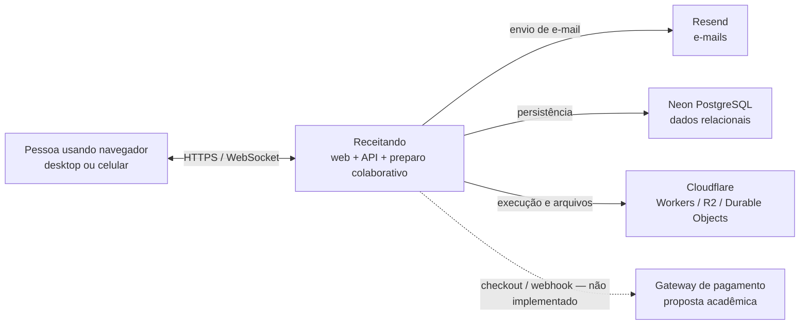
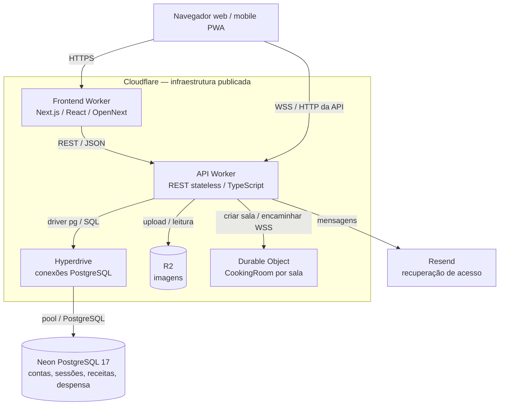
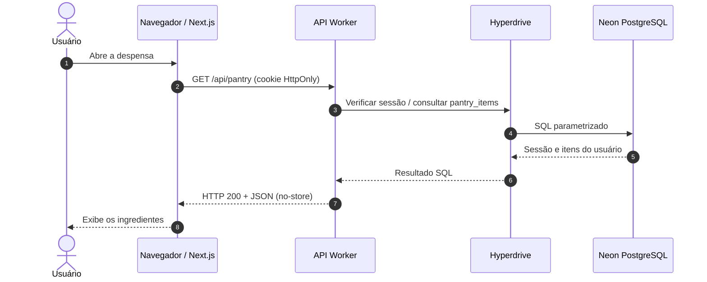
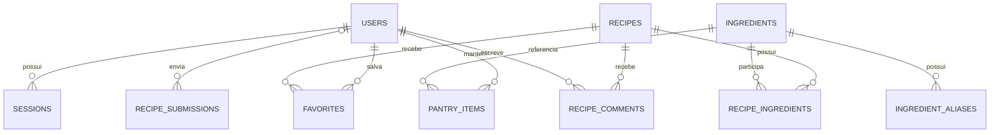
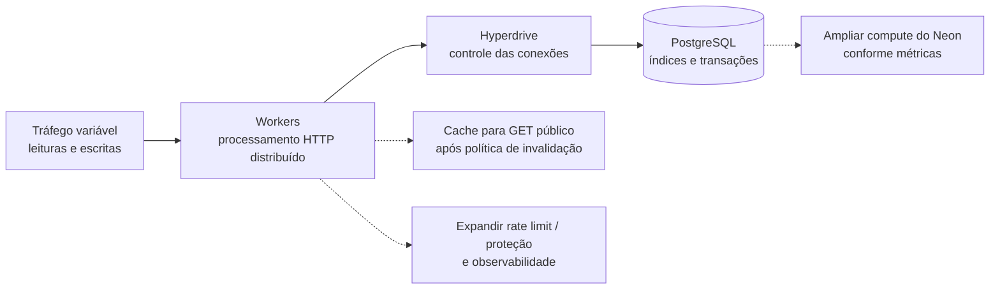
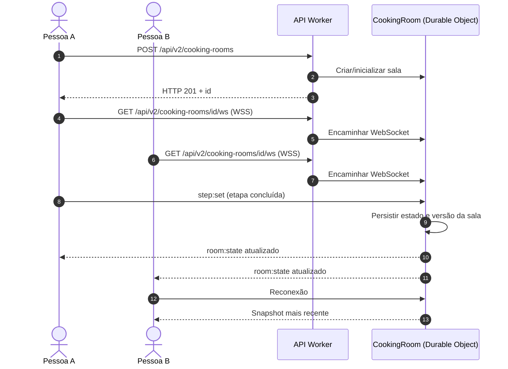
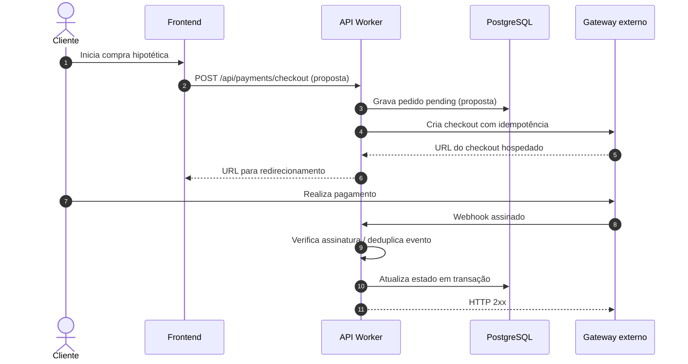

# Receitando — System Design e infraestrutura

**Documento de arquitetura do projeto | Fase 4 — Engenharia de Software**  
**Estado:** arquitetura publicada + estratégias de evolução identificadas. **Fonte:** [código do Receitando](https://github.com/pitado/receitando) e [documentação da aplicação](README.md).

> **Leitura dos diagramas:** linhas contínuas representam fluxos/componentes existentes; linhas tracejadas representam opções **propostas**, ainda não implementadas. A arquitetura projetada não equivale a capacidade de produção certificada.

## 1. Escopo e requisitos

O Receitando ajuda a descobrir receitas a partir de ingredientes disponíveis, manter uma despensa, compartilhar receitas e cozinhar com outras pessoas em tempo real.

| Requisito | Solução arquitetural |
| --- | --- |
| Frontend web/mobile | Next.js 16 + React 19, interface responsiva/PWA (**não** app nativo) |
| Backend HTTP stateless | API REST/JSON em Cloudflare Workers; sessões fora da memória do Worker |
| Dados relacionais | Neon PostgreSQL 17 via Cloudflare Hyperdrive + `pg` |
| Imagens | Cloudflare R2; conteúdo binário fora das tabelas relacionais |
| Colaboração em tempo real | WebSocket e Durable Objects por sala |
| Alta volumetria | Estratégia para **1 milhão de escritas + 2 milhões de leituras**; horizonte temporal explicitado na seção 6 |
| Integrações | Resend (e-mail) e mapeamento de **pagamentos hipotéticos**, sem checkout ativo |

Requisitos de qualidade orientadores: consistência, segurança de sessão, latência, disponibilidade, evolução independente dos componentes e observabilidade. Detalhes funcionais estão em [escopo](escopo.md) e [funcionalidades](funcionalidades.md).

## 2. Contexto — quem usa e de que depende

**Limite do sistema:** o navegador não possui acesso direto ao PostgreSQL ou às credenciais dos provedores. Recursos de pagamento não existem na versão atual.

## 3. Arquitetura de containers e infraestrutura

| Componente | Por que está separado? | Trade-off |
| --- | --- | --- |
| Workers REST | Processamento HTTP distribuído, sem afinidade com instância | Dependência dos serviços de dados e limites da plataforma |
| PostgreSQL | Transações, FKs e consultas relacionais para receitas/ingredientes/usuários | CPU, I/O, conexões e contenção de escrita |
| Hyperdrive | Gerencia conectividade/pooling dos Workers com o banco | **Não aumenta sozinho** o poder de processamento do PostgreSQL |
| R2 | Fotos não sobrecarregam armazenamento/transações SQL | Permissões, consistência operacional entre upload e registro SQL |
| Durable Objects | Uma autoridade de estado por sala de WebSocket | Gestão de conexões, limites e ciclo de vida da sala |

Código: [roteador](../backend/worker-prototype/src/app-router.ts) · [adaptador PostgreSQL](../backend/worker-prototype/src/lib/postgres-adapter.ts) · [configuração da API](../backend/worker-prototype/wrangler.jsonc) · [diagrama de componentes editável](../receitando-diagrama-componentes.puml).

## 4. Fluxo REST stateless

Exemplo de operação autenticada na despensa:

**Stateless:** a API não conserva sessão na memória do Worker entre requisições. Cookies identificam a sessão, cujo estado é persistido no PostgreSQL. Mutação exige autorização e validação adequada; a API aplica políticas como CORS/Origin, hash de senhas, consultas parametrizadas e rate limiting nas rotas de autenticação. [Contrato REST](api.md) · [segurança](../SECURITY.md).

## 5. Modelo de dados — entidades essenciais

O **relacionamento muitos-para-muitos** entre receitas e ingredientes utiliza `recipe_ingredients`. A busca textual possui índice GIN no PostgreSQL; `recipe_search` é uma **VIEW**, não uma tabela FTS5. As regras de integridade e as transações seguem o [schema PostgreSQL versionado](../backend/worker-prototype/migrations/postgres/0001_baseline.sql).

**[Ver DER completo e renderizado](../DER.md)** · [fonte UML editável](../DER.puml) · [detalhes do banco](database.md).

## 6. Escalabilidade — 1 milhão de escritas e 2 milhões de leituras

**O enunciado não determina uma janela temporal.** As taxas abaixo são médias aritméticas para duas hipóteses; não representam picos nem capacidade já garantida.

| Janela hipotética | 1M escritas | 2M leituras | Total |
| --- | ---: | ---: | ---: |
| **24 horas** (86.400 s) | **11,57/s** | **23,15/s** | **34,72 operações/s** |
| **1 hora** (3.600 s) | **277,78/s** | **555,56/s** | **833,33 operações/s** |

**Estratégia por gargalo:**

| Risco observado | Mitigação / decisão | Como verificar |
| --- | --- | --- |
| Muitas requisições HTTP | Distribuição nos Workers; limites de taxa onde necessários | req/s, HTTP 429/5xx, p95/p99 |
| Pool ou banco saturado | Monitorar Hyperdrive/conexões, dimensionar compute Neon | conexões, erros, CPU, I/O |
| SQL caro ou concorrente | Índices, paginação, `EXPLAIN`, transações curtas | queries lentas, locks, tempo por consulta |
| Fotos sobrecarregando SQL | Armazenamento dos arquivos em R2 (**em uso**) | operações e custos por serviço |
| Pico/indisponibilidade | Timeouts, backoff e degradação planejada; validar recuperação | erros, latência, recuperação e alertas |

**Estado de implementação:** Workers, Hyperdrive, PostgreSQL, R2 e controle de sessão existem. **Cache de GET públicos, ampliação de compute, réplicas de leitura e filas são estratégias condicionais**, não infraestrutura já comprovadamente implantada. Réplicas não resolvem gargalo de escrita. Uma hipótese de pico **10×** exige validação específica, não deve ser apresentada como garantida.

**Dimensionamento de armazenamento:** 1 milhão de **operações de escrita** não significa necessariamente 1 milhão de novas linhas permanentes. Para estimar GB, ainda seria necessário conhecer o tamanho dos registros, a retenção, os índices e a proporção de INSERT/UPDATE/DELETE.

**Evidências, não promessas:** [testes e metodologia](../tests/load/README.md) incluem ensaio SQL em branch Neon isolada e ensaio HTTP limitado (1.000 POSTs + 2.000 GETs, 0 falhas) com Worker/Hyperdrive/PostgreSQL isolados. **Não comprovam 3 milhões de requisições HTTP nem operação contínua sob pico.**

## 7. WebSocket — Receitando Juntos (implementado)

Cada sala é coordenada por seu Durable Object, **sem transformar o Worker REST em stateful**. A solução contempla presença, atualizações concorrentes, reconexão, máximo de **12 conexões** por sala e validade lógica de **24 horas**. O estado colaborativo da sala **não é uma escrita na tabela de receitas do Neon**.

[Implementação](../backend/worker-prototype/src/cooking-room.ts) · [especificação e testes](receitando-juntos.md) · [sequência UML de matching](../Diagrama-de-Sequencia.md).

## 8. Pagamentos — mapeamento exigido, NÃO implementado

O Receitando é gratuito; **não existe checkout, assinatura nem `/api/payments/checkout` na API atual**. O fluxo abaixo é uma **proposta de integração** caso o produto venha a cobrar pagamentos.

**Fronteiras de segurança da proposta:** credenciais apenas no servidor, valor validado pelo backend, checkout hospedado, assinatura do webhook, estados e idempotência; **sem armazenamento de cartão no Receitando**. O gateway é uma dependência externa prevista, não uma integração já contratada.

## 9. Riscos e justificativas para a defesa pública

| Pergunta da banca | Resposta arquitetural |
| --- | --- |
| Por que REST stateless? | Permite processar requisições em Workers sem sessão vinculada à instância; persistência fora do processo. |
| Por que PostgreSQL e não apenas KV/NoSQL? | Receitas, ingredientes, usuários e moderação têm relações, FKs e operações transacionais. |
| Hyperdrive faz o banco escalar? | **Não**: controla conexões, mas CPU/I/O/locks do PostgreSQL continuam limitantes. |
| Como REST e WebSocket convivem? | REST fica stateless; Durable Object mantém a autoridade de estado por sala. |
| O que acontece com 10× o tráfego? | É cenário a dimensionar e testar, monitorando picos, banco, conexões e custos — não promessa de capacidade. |
| Onde pode haver falha? | Neon, rede/provedores externos, R2, sala WebSocket e consultas; medir erros, latência e recuperação. |

**Conclusão:** a arquitetura separa HTTP, dados relacionais, arquivos e tempo real para permitir evolução com responsabilidades claras. Ela apresenta **um caminho para a volumetria exigida**, mas não substitui dimensionamento de recursos e validação em cargas representativas.

### Referências técnicas do próprio projeto

[Diagrama de componentes — ver desenho](../Diagrama-de-Componentes.md) · [DER — ver desenho](../DER.md) · [Diagrama de sequência — ver desenho](../Diagrama-de-Sequencia.md) · [Modelo PostgreSQL](database.md) · [API](api.md) · [Testes](../tests/load/README.md) · [Documentação geral](README.md).
