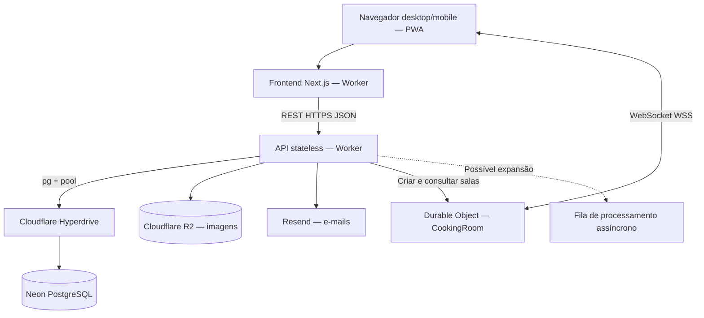
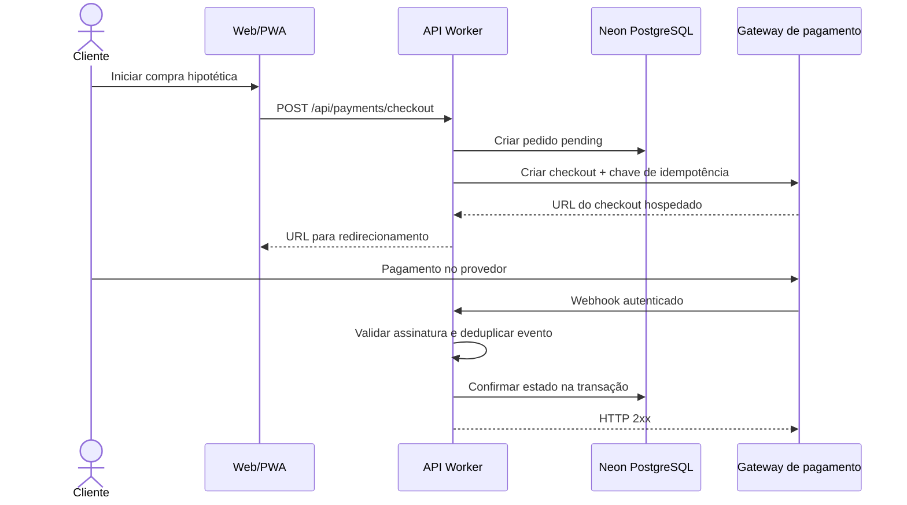
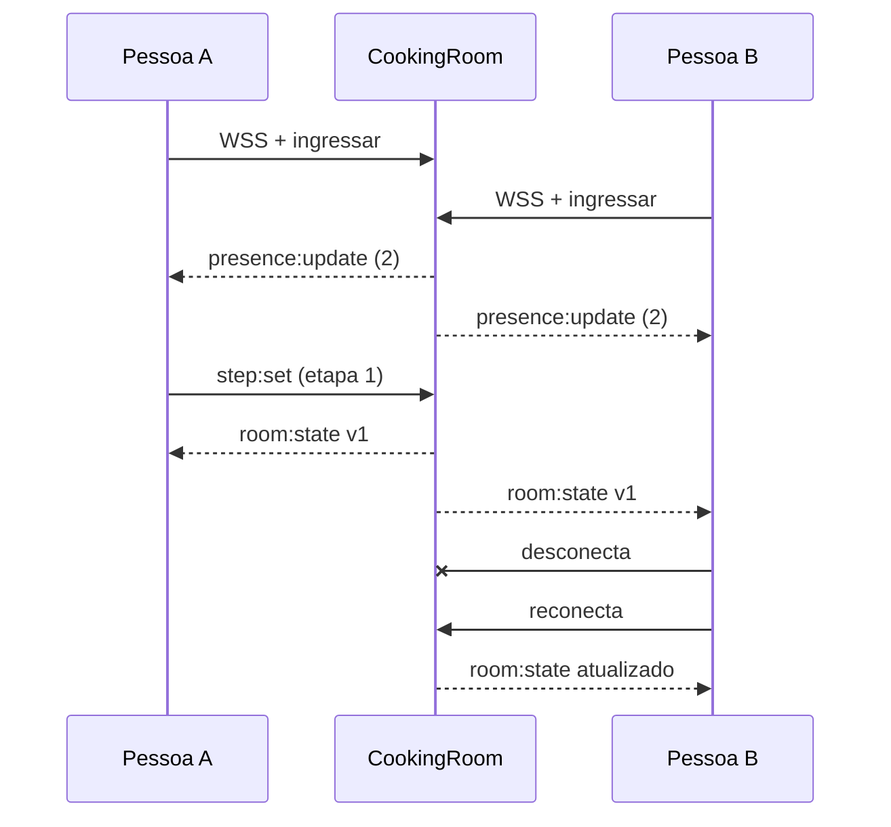

# Fase 4 — System Design e Infraestrutura | Receitando
**Referência: 31/10/2026 — Documento de arquitetura para o seminário acadêmico.**

## 1. Objetivo e requisitos obrigatórios
Desenhar arquitetura técnica de alta volumetria e exigências corporativas: **backend REST stateless**, **frontend web/mobile**, estratégia de **1 milhão de escritas para cada 2 milhões de leituras**, mapeamento de **API de pagamento** e comunicação por **WebSocket**. Esta entrega documenta decisões, evidências, limites e evolução proposta; o roteiro da defesa oral será feito em slides separados.

## 2. Componentes atuais e responsabilidades
| Componente | Tecnologia | Justificativa |
| --- | --- | --- |
| Frontend web/mobile | Next.js 16, React 19, TypeScript, OpenNext / Cloudflare Workers | Interface responsiva/PWA, renderização e deploy na borda; não há aplicativo nativo |
| API REST | Worker TypeScript separado, JSON/HTTPS | Processamento horizontal e sem estado de sessão na memória da instância |
| Sessões e dados | Neon PostgreSQL 17 | ACID, integridade, índices, relatórios e modelagem relacional |
| Conectividade SQL | Cloudflare Hyperdrive + `pg` | Gerenciamento de conexões entre Workers e PostgreSQL |
| Imagens | Cloudflare R2 | Armazenamento de arquivos fora do banco relacional |
| Salas ao vivo | Cloudflare Durable Objects + WebSocket | Coordenação do estado por sala, presença e etapas sincronizadas |
| E-mails | Resend | Recuperação de acesso e mensagens transacionais |
| Entrega contínua | GitHub Actions | Verificação e deploy automatizados |

**Linhas contínuas são existentes.** A fila pontilhada é proposta, não implementada. Durable Objects guardam estado de cada sala; isso não contradiz o **REST stateless**, que não conserva sessão na memória do Worker HTTP. Os dados de conta e conteúdo residem no PostgreSQL.

## 3. Estratégia de escalabilidade: 1M writes / 2M reads
O enunciado **não fixa a janela temporal**; por isso adotamos dois cenários de dimensionamento.

| Janela hipotética | Escritas/s (média) | Leituras/s (média) | Total/s (média) |
| --- | ---: | ---: | ---: |
| 24 horas | 11,57 | 23,15 | 34,72 |
| 1 hora | 277,78 | 555,56 | 833,33 |

A média não descreve horário de pico; deve-se considerar, como hipótese de projeto, até **10× a média** e validar em staging. O sistema deverá escalar por camadas:
1. **Computação:** Workers stateless distribuem requisições HTTP sem afinidade de sessão; aplicar limitação de taxa, validação e timeout.
2. **Conexões:** Hyperdrive reduz pressão de abertura de conexões; verificar métricas de saturação, limites e política de pool.
3. **PostgreSQL:** `PRIMARY KEY`, FKs, índices B-tree, full-text, paginação, parâmetros SQL, análise de planos e redução de consultas repetidas; dimensionar CPU/memória/IO do compute Neon. Réplicas de leitura podem ser avaliadas, mas **não resolvem gargalo de escrita**.
4. **Cache:** permitir cache na borda **somente** para respostas públicas seguras após revisar rotas; conteúdo de sessão e dados privados ficam sem cache compartilhado.
5. **Tarefas demoradas:** mover notificações e trabalhos não críticos para filas **quando necessário**, com idempotência, retries e dead-letter queue.
6. **Monitoramento:** p50/p95/p99, erros 5xx, taxa de escrita/leitura, conexões, CPU/IO, locks, custo, filas e alertas.
7. **Resiliência:** isolamento de falhas, políticas de retentativa com backoff, consistência e plano de backup/restauração.

**Ponto de atenção:** capacidade configurada do compute Neon é limitada e deve ser aumentada se os testes de carga apontarem saturação. A arquitetura admite expansão, mas *não há garantia de escala apenas pela escolha de tecnologias*.

## 4. Evidência real obtida no PostgreSQL
**Executado em 31/10/2026** no Neon PostgreSQL **17.11**, branch isolada `benchmark-fase4-20261031` (separada da branch `production`), com dados **sintéticos**:
- **1.000.000 de linhas gravadas**, verificadas por `SELECT COUNT(*)`.
- **2.000.000 de buscas indexadas com resultado** em consulta correlacionada usando `generate_series(1,2000000)`.
- Tabela dedicada `fase4_benchmark`: **102 MB** (tabela e índices).
- Amostra `EXPLAIN (ANALYZE, BUFFERS)` de 20.000 buscas: **Index Only Scan** sobre `fase4_benchmark_pkey`, **20.000 loops**, **0 heap fetches**, **31,410 ms de tempo de execução** dentro do servidor para a amostra.

**Limite da evidência:** as operações foram executadas dentro do PostgreSQL em comandos SQL agrupados. Isso **não é** um benchmark de 3 milhões de requisições REST individuais ou de usuários simultâneos; não mede p95 da API, Hyperdrive sob carga nem throughput sustentado por uma hora/dia. O resultado sustenta a escolha do banco e a estratégia, não a alegação de capacidade de produção já certificada. Metodologia e SQL: [testes de carga](../tests/load/README.md).

**Plano de homologação HTTP:** usar k6 em Worker staging + Hyperdrive + Neon isolado, testar 1:2 operações na janela definida, ramp-up, patamar sustentado, pico e recuperação. Critérios iniciais: **erro inferior a 1% e p95 inferior a 1 s**; confirmar p99, vazão e persistência. Não afetar usuários reais.

### Evidência complementar — chamadas HTTP reais em produção (31/10/2026)

- **Cloudflare Worker + Durable Objects:** **1.000 POSTs (HTTP 201) + 2.000 GETs (HTTP 200)**, nenhuma falha, p95 POST **730,35 ms**, p95 GET **56,55 ms**, média **21,97 req/s**, [execução e artefatos](https://github.com/pitado/receitando/actions/runs/41231664394).
- **Cloudflare Worker + Hyperdrive + Neon PostgreSQL (leitura de catálogo):** **2.000 GETs (HTTP 200)**, 12 requisições concorrentes no cliente de carga, nenhuma falha, p95 **515,85 ms**, média **26,19 req/s**, [execução e artefatos](https://github.com/pitado/receitando/actions/runs/41231920170).

Esses são **testes HTTP reais em produção**, mas **nenhum executou escritas SQL via API de produção**. As escritas HTTP são persistidas em Durable Objects. Os resultados não certificam os 34,72 ops/s médios durante 24h, nem os 3 milhões de HTTP requests do cenário acadêmico. A arquitetura pode ser dimensionada para o objetivo; a configuração atual ainda exige benchmark representativo e prolongado para afirmar que a meta foi atingida.

### Teste HTTP de escrita e leitura no PostgreSQL pela Cloudflare — APROVADO

**[Execução real no GitHub Actions (31/10/2026)](https://github.com/pitado/receitando/actions/runs/41232599160).** Um Worker remoto dedicado reutilizou o roteador REST e a integração `pg` do Receitando, conectado via Hyperdrive **exclusivo** ao Neon PostgreSQL de benchmark (branch isolada, sem acesso à base de usuários).

- **POSTs HTTP que gravaram no PostgreSQL:** 1.000 de 1.000.
- **GETs HTTP com SELECT no PostgreSQL:** 2.000 de 2.000.
- **Linhas persistidas após o teste:** +1.000 confirmadas no banco.
- **Falhas:** 0/3.000. **Latência p95:** 206,77 ms. **Vazão média:** 42,59 requisições por segundo, sendo 14,20 escritas/s e 28,39 leituras/s.
- **Concorrência k6:** 6 VUs de escrita e 12 VUs de leitura. O Worker temporário foi excluído ao final.

A vazão observada supera a **média calculada para 3 milhões de operações distribuídas em 24 horas** (34,72 ops/s); contudo, o cenário real executou **3.000 requisições**, e não 3 milhões, durante uma janela curta. Portanto, não comprova uma operação contínua de 24h ou de 3M HTTP requests e nem valida transações reais do produto na instância principal do Neon.

[Detalhes, scripts e evidências](../tests/load/README.md).

## 5. Mapeamento de integração de pagamento — exigência do enunciado
**Projeto gratuito:** não há checkout ou assinatura ativos. A monetização prevista por Google AdSense é publicidade, **não** API de cobrança. Para cumprir a exigência de *mapeamento*, projetamos uma integração **hipotética** com Mercado Pago ou Stripe, sem ativar pagamentos:

**Segurança e consistência:** valor validado no servidor, sem armazenar cartão, segredos fora do Git, TLS, verificação criptográfica do webhook, idempotência, deduplicação por ID do evento, estados `pending/paid/failed/refunded`, reconciliação e retentativas. **Essas rotas não existem no produto atual**; mapa técnico não significa integração implementada.

## 6. Mapeamento WebSocket — implementado
`POST /api/v2/cooking-rooms` cria sala com etapas; `GET /api/v2/cooking-rooms/:id` consulta estado; `GET /api/v2/cooking-rooms/:id/ws` faz upgrade WSS. Cada sala é um Durable Object isolado: estado, participantes, controle de versão, heartbeat, expiração em 24h e máximo de 12 conexões. A mensagem `step:set` confirma etapa e retransmite `room:state` aos demais. O reingresso recupera snapshot; operações idempotentes não avançam versão indevidamente. Teste automatizado local com **dois clientes WebSocket** cobre sincronização bidirecional, edições simultâneas, reconexão e presença. Demonstração em dois navegadores na produção requer evidência específica.

## 7. Defesa arquitetural — argumentos verificáveis
- **Por que REST stateless?** Facilita escalabilidade horizontal e implantação sem vincular usuário a uma instância.
- **Por que PostgreSQL?** Integridade e consultas relacionais para receitas, ingredientes, despensa, usuários e moderação.
- **Por que Hyperdrive?** Camada de conexão/pool entre Worker e Postgres; não substitui o banco.
- **Por que R2?** Desacopla fotos de transações do banco.
- **Por que Durable Objects para WebSocket?** Uma autoridade por sala simplifica ordenação e concorrência; o REST continua stateless.
- **Onde pode falhar?** Banco subdimensionado, pool saturado, SQL sem índice, cache inseguro, picos, custo, timeouts e indisponibilidade externa.
- **Como provar?** Diagrama coerente, código/configuração verificável, amostra SQL real, k6 HTTP em staging, métricas e limites explícitos.

Links: [configuração da API](../backend/worker-prototype/wrangler.jsonc), [schema](../backend/worker-prototype/migrations/postgres/0001_baseline.sql), [diagrama](diagramas/componentes.md), [WebSocket](receitando-juntos.md), [teste PostgreSQL](../tests/load/README.md).
