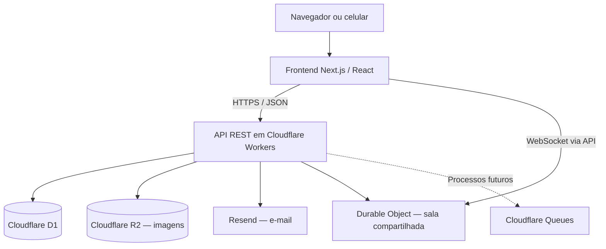
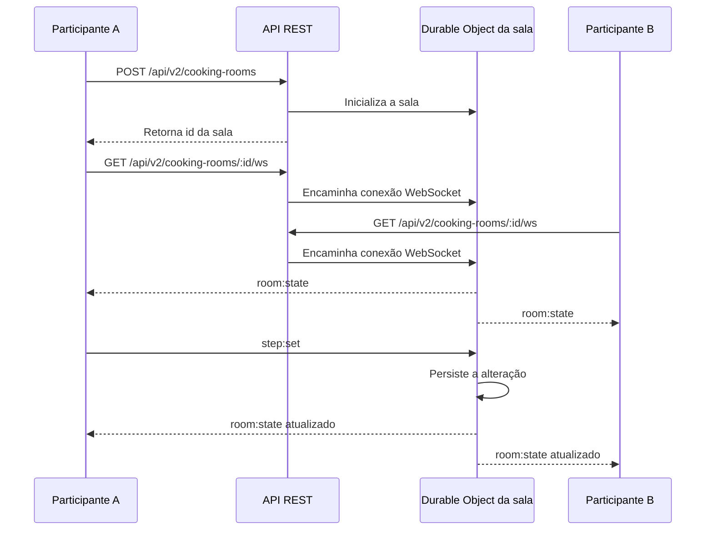
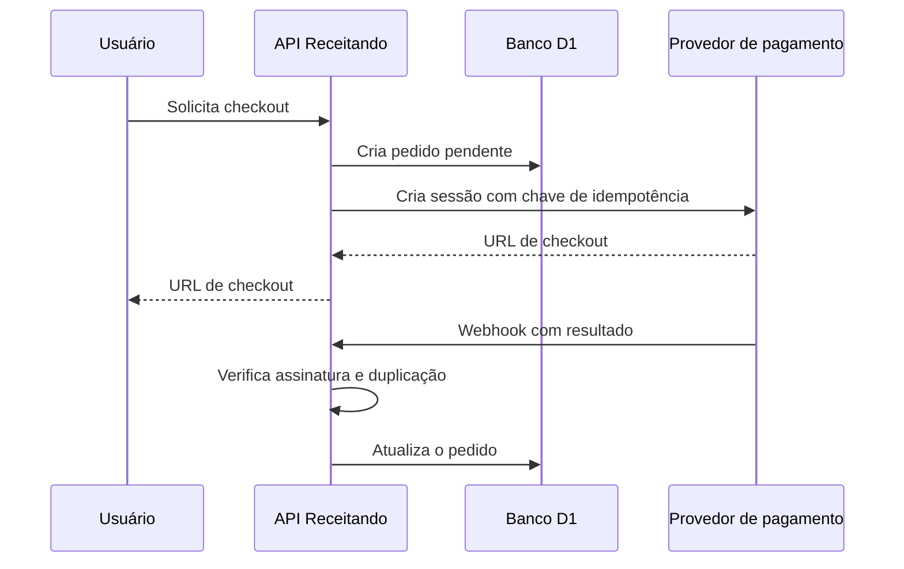

# Receitando — arquitetura e infraestrutura

O Receitando reúne receitas, despensa, favoritos e ferramentas para encontrar o que cozinhar com os ingredientes disponíveis. A aplicação funciona no navegador, inclusive em celulares, e utiliza uma API separada para lidar com os dados. Este documento apresenta a estrutura usada hoje e como ela pode evoluir para atender a um volume maior de acessos.

## Como o sistema está organizado

A interface foi desenvolvida com **Next.js 16, React 19 e TypeScript**. É uma aplicação web responsiva/PWA, não um aplicativo nativo de Android ou iOS. O frontend e a API são publicados em **Cloudflare Workers**, como serviços independentes.

A API expõe rotas REST por HTTPS e não depende de guardar a sessão na memória de uma instância específica. O token de sessão é enviado por cookie `HttpOnly`, e a validação usa dados persistidos. Assim, requisições sucessivas podem ser atendidas por instâncias diferentes do Worker.

A persistência usa **Cloudflare D1 (SQLite)**, enquanto as imagens ficam no **R2**. A integração com **Resend** atende ao envio de e-mails de recuperação de senha. Para as salas de preparo compartilhado, a implementação usa **WebSocket** e **Durable Objects**, que mantêm o estado de cada sala.

O diagrama separa a comunicação REST tradicional da parte colaborativa. A fila pontilhada é uma possibilidade de evolução; ela não está configurada no ambiente atual.

## Por que escolhemos essa estrutura

O **Next.js** permite aproveitar o mesmo projeto para desktop e celular. Separar a API da interface facilita manter as regras de negócio fora do frontend e organizar as rotas por responsabilidade.

Escolhemos **Workers** para não precisar administrar um servidor dedicado para cada aplicação. Isso simplifica o deploy e permite ampliar a camada de execução conforme a demanda. A escalabilidade, porém, também depende dos serviços chamados por cada requisição.

O **D1** atende ao modelo relacional do projeto — usuários, receitas, ingredientes, favoritos e demais relações — e trabalha diretamente com os Workers. Sua principal limitação é que cada banco processa consultas de maneira sequencial, por isso a concorrência de escrita merece atenção. O **R2** evita guardar imagens como arquivos binários no banco de dados.

## Como atender a 1 milhão de escritas e 2 milhões de leituras

O volume solicitado é de **3 milhões de operações**, sendo um terço de escritas e dois terços de leituras. Para dimensionar corretamente, precisamos considerar o período em que essas operações acontecem.

| Período considerado | Escritas por segundo | Leituras por segundo | Total por segundo |
| --- | ---: | ---: | ---: |
| 24 horas | 11,57 | 23,15 | 34,72 |
| 1 hora | 277,78 | 555,56 | 833,33 |

Como o requisito não informa uma janela, adotamos **24 horas como referência inicial**, sem descartar cenários mais exigentes. Também precisamos levar em conta picos: uma média de 34,72 operações/s pode esconder momentos de tráfego muito maior.

Nossa estratégia parte de quatro decisões:

1. **Reduzir leituras desnecessárias.** Respostas públicas e pouco alteradas, como partes do catálogo, poderão usar cache na borda. Dados de usuário e conteúdo autenticado não devem ser compartilhados em cache. Hoje a política de cache por rota ainda precisa ser revisada antes dessa otimização.
2. **Manter consultas eficientes.** Índices, paginação e busca pelo FTS5 ajudam a evitar varreduras grandes. Vamos acompanhar os planos de consulta e ajustar os pontos mais acessados.
3. **Separar tarefas que não precisam terminar junto da resposta.** Notificações e processamento secundário poderão usar Cloudflare Queues, com tentativas de reprocessamento e controle para evitar duplicação. Filas ajudam a absorver picos, mas não aumentam, sozinhas, o limite de escrita do D1.
4. **Reavaliar a persistência quando necessário.** Réplicas do D1 podem aliviar leituras, respeitando a consistência exigida, mas não aumentam a capacidade de escrita do banco principal. Se as medições apontarem esse gargalo, o próximo passo será estudar particionamento de dados ou outra solução de banco.

O objetivo é dimensionar a infraestrutura com base nas medições, não apenas aumentar a quantidade de instâncias da API.

## Testes que já realizamos

Usamos **k6**, executado pelo GitHub Actions, para observar a resposta da API sob concorrência. Os números abaixo são de um **D1 local executado pelo Wrangler no runner do GitHub**, não de um teste de carga no serviço de produção.

| Medida | Teste misto de 30/10/2026 |
| --- | ---: |
| Escritas concluídas | 774 |
| Leituras concluídas | 1.548 |
| Total de requisições | 2.322 |
| Falhas HTTP | 0% |
| Latência p95 | 8,62 ms |
| Duração | 90 s |
| Concorrência | Até 10 usuários virtuais |

[Execução do teste misto no GitHub Actions](https://github.com/pitado/receitando/actions/runs/40988074830/job/123843668166)

A proporção de uma escrita para duas leituras funcionou nesse ensaio, mas o teste **não comprova** que a produção suporta 3 milhões de operações em qualquer intervalo. A primeira tentativa de grande volume também não teve sucesso; por isso ajustamos os endpoints e a forma de verificar as leituras e a persistência.

Há um cenário maior preparado no Actions, com 1 milhão de inserções e 2 milhões de consultas indexadas em banco local. O script confere a quantidade de registros gravados e gera um relatório próprio. **Ainda não há resultado aprovado desse cenário na versão atual.** Os detalhes ficam em [testes de carga](../tests/load/README.md).

## Integração em tempo real: Receitando Juntos

Pensamos no **Receitando Juntos** para duas ou mais pessoas acompanharem o preparo de uma receita na mesma sala. A API cria a sala e o Durable Object guarda suas etapas. Cada participante abre um WebSocket; quando alguém marca uma etapa como concluída, a alteração é persistida e enviada aos demais.

As rotas previstas no código são:

| Rota | Função |
| --- | --- |
| `POST /api/v2/cooking-rooms` | Criar uma sala com receita, título e etapas |
| `GET /api/v2/cooking-rooms/:id` | Consultar o estado atual |
| `GET /api/v2/cooking-rooms/:id/ws` | Abrir a conexão WebSocket |

O objeto da sala limita a participação a 12 conexões, mantém um prazo de 24 horas e valida as alterações das etapas antes de salvá-las. A estrutura está no código e o binding `COOKING_ROOMS` existe na Cloudflare. A demonstração completa entre dois dispositivos ainda precisa ser validada antes de tratarmos o recurso como concluído.

O [mapeamento detalhado do WebSocket](websocket-receitando-juntos.md) inclui as mensagens trocadas e os cuidados de implementação.

## Integrações externas e pagamentos

O Receitando foi pensado para ser **gratuito**. A forma de monetização estudada é a publicidade com **Google AdSense**, que ainda não deve ser tratada como integração ativa. Por esse modelo de negócio, não existe checkout nem cobrança dos usuários.

Mesmo assim, documentamos como uma API de pagamento poderia ser integrada caso o produto oferecesse algum serviço pago no futuro. A comunicação ficaria concentrada no backend, sem expor credenciais ao navegador. O fluxo seria:

1. O frontend solicita ao Worker a criação de um pedido.
2. O Worker registra o pedido no D1 e chama um provedor de pagamento (por exemplo, Mercado Pago ou Stripe), usando uma chave de idempotência para evitar cobranças repetidas.
3. O usuário é encaminhado ao checkout do provedor.
4. O provedor informa o resultado por webhook; a API valida a autenticidade da mensagem, evita processar eventos duplicados e atualiza o pedido.

Esse é um **mapeamento de arquitetura**, não uma funcionalidade implementada. O Google AdSense, por sua vez, é publicidade e não substitui uma API de pagamentos.

## O que verificamos na Cloudflare

Na consulta à conta em **30/10/2026**, encontramos dois Workers publicados: `receitando`, para o frontend, e `round-mouse-8bbd`, para a API. O backend possui bindings para o banco D1 principal, o bucket R2 de imagens, o Durable Object `CookingRoom` e a integração de e-mail com Resend. Os logs de execução estão habilitados.

O D1 de produção possui 22 tabelas. Existe também um banco de benchmark separado na conta, mas **os resultados do k6 citados acima foram obtidos no D1 local**, não nesse banco remoto. As réplicas de leitura do D1 principal estão desativadas e não há filas Cloudflare Queues configuradas.

Por isso, a arquitetura está preparada para evoluir, mas o suporte efetivo à meta de 3 milhões de operações na infraestrutura remota ainda exige medição específica.

## Materiais do projeto

- [Arquitetura da aplicação](architecture.md)
- [Diagrama de componentes](diagramas/componentes.md)
- [WebSocket do Receitando Juntos](websocket-receitando-juntos.md)
- [API](api.md) e [estrutura do banco](database.md)
- [Testes de carga](../tests/load/README.md)
- [Roteiro para apresentação](defesa-arquitetura.md)
