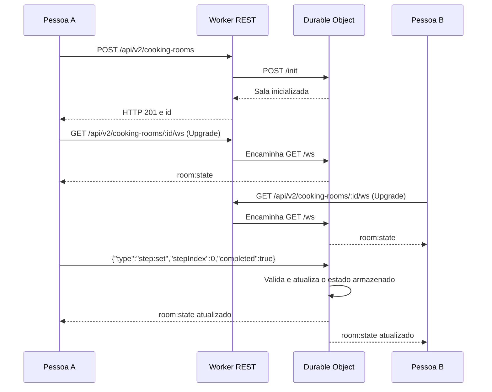

# Receitando Juntos — comunicação por WebSocket

O Receitando Juntos permite acompanhar as etapas de uma receita em uma sala compartilhada. A ideia é simples: uma pessoa cria a sala, compartilha o identificador ou um link de convite e as demais acompanham o preparo sem precisar atualizar a página.

## Como a comunicação funciona

A API REST cuida da criação e da consulta inicial. Depois que a conexão WebSocket é aberta, um **Durable Object** fica responsável pela sala: guarda o estado, recebe as alterações e envia a versão atualizada aos participantes conectados. Isso evita depender da memória de uma instância aleatória do Worker.



A resposta da criação contém o **ID da sala**. A construção e o compartilhamento do link de convite ficam a cargo da interface.

## Rotas da API

| Método e caminho | Resposta esperada | Uso |
| --- | --- | --- |
| `POST /api/v2/cooking-rooms` | `201` com `{ "id": "..." }` | Cria uma sala; recebe `recipeSlug`, `title` e `steps` |
| `GET /api/v2/cooking-rooms/:id` | JSON com o estado | Permite recuperar a sala sem WebSocket |
| `GET /api/v2/cooking-rooms/:id/ws` | `101 Switching Protocols` | Estabelece o WebSocket da sala |

Uma requisição ao endpoint `/ws` sem o cabeçalho correto de upgrade recebe `426`.

## Mensagens trocadas

**Cliente → sala: marcar ou desmarcar uma etapa**

```json
{ "type": "step:set", "stepIndex": 0, "completed": true }
```

`stepIndex` identifica a etapa no array da receita (começa em zero). `completed` informa se ela foi concluída.

**Sala → clientes: estado atualizado**

```json
{
  "type": "room:state",
  "recipeSlug": "panqueca-de-banana",
  "title": "Panqueca de banana",
  "steps": ["Separar os ingredientes", "Misturar", "Cozinhar"],
  "completed": [true, false, false],
  "version": 1,
  "createdAt": 0,
  "onlineCount": 2
}
```

*Exemplo ilustrativo da estrutura da mensagem; `createdAt` recebe o horário real de criação da sala em milissegundos.*

**Sala → clientes: presença**

```json
{ "type": "presence:update", "onlineCount": 2 }
```

O Durable Object também configura resposta automática ao heartbeat `{"type":"ping"}` com `{"type":"pong"}`.

## Persistência e limites

O estado da sala é salvo no armazenamento do Durable Object. As alterações usam transação para evitar perda de atualização quando dois participantes mexem na mesma etapa. O campo `version` aumenta quando o estado muda.

O código estabelece alguns limites: até **12 participantes conectados**, no máximo **100 etapas** na criação, mensagens WebSocket de até **1.024 caracteres** e expiração da sala após **24 horas**. A API também valida `Origin` quando presente e rejeita dados de criação inválidos.

A sala é identificada por um UUID difícil de adivinhar. Isso ajuda a proteger convites, mas não substitui autenticação e regras de permissão se o recurso passar a lidar com informações sensíveis.

## O que já existe e o que falta verificar

A implementação está em:

- [Roteamento das salas — `app-router.ts`](../backend/worker-prototype/src/app-router.ts)
- [Estado e eventos — `cooking-room.ts`](../backend/worker-prototype/src/cooking-room.ts)
- [Configuração do binding — `wrangler.jsonc`](../backend/worker-prototype/wrangler.jsonc)

A Cloudflare já possui um namespace de Durable Objects ligado ao Worker da API. Isso confirma que o componente está configurado.

Ainda é necessário confirmar em um teste ponta a ponta que dois dispositivos conseguem entrar na mesma sala, receber a alteração de uma etapa e recuperar o estado após reconexão. Até lá, tratamos a sincronização entre dispositivos como **implementada no backend e pendente de validação funcional**.
